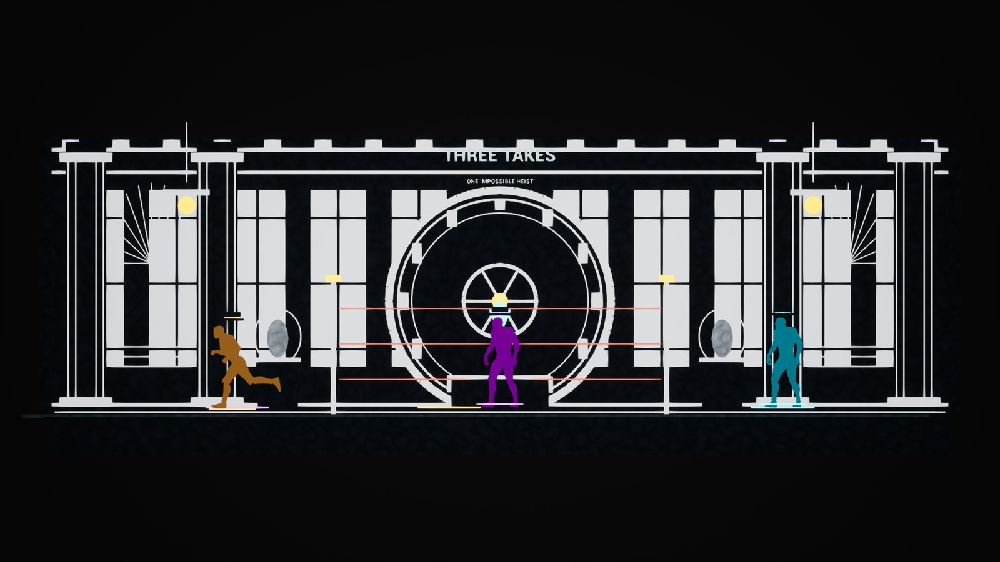
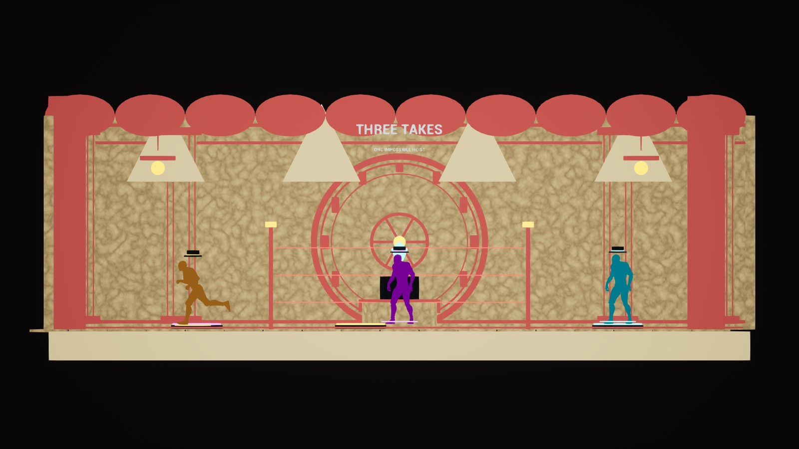
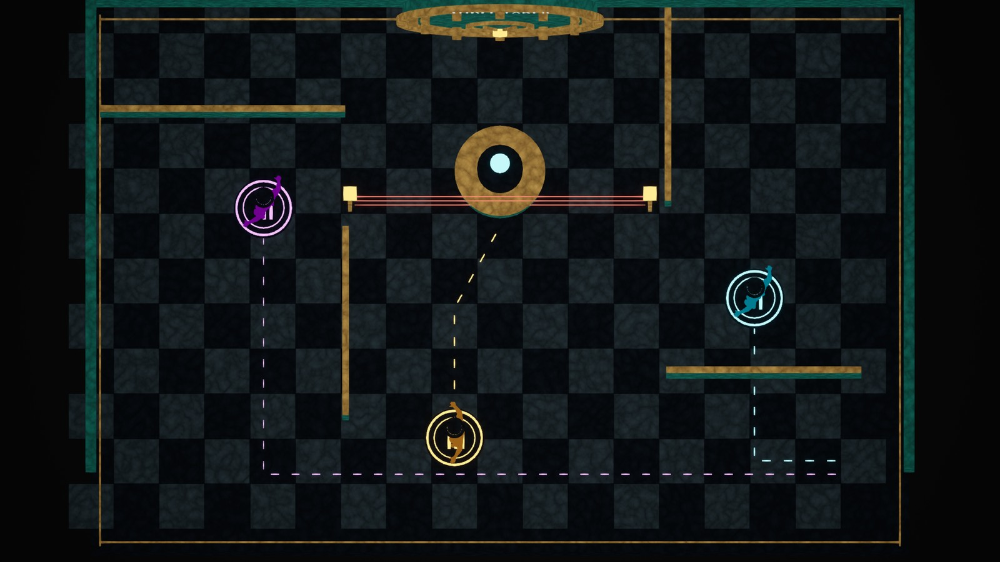
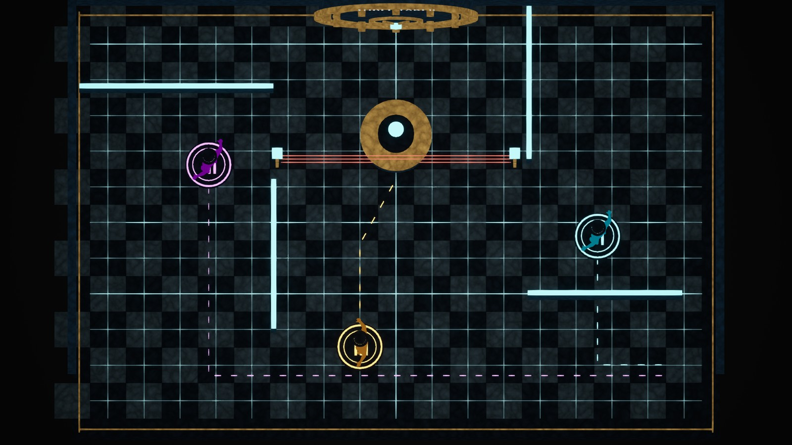
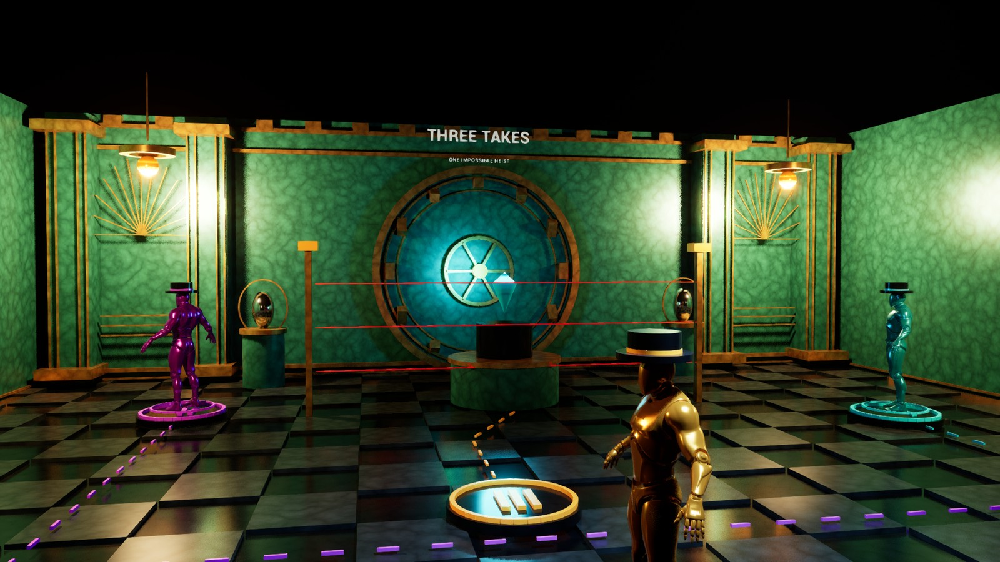
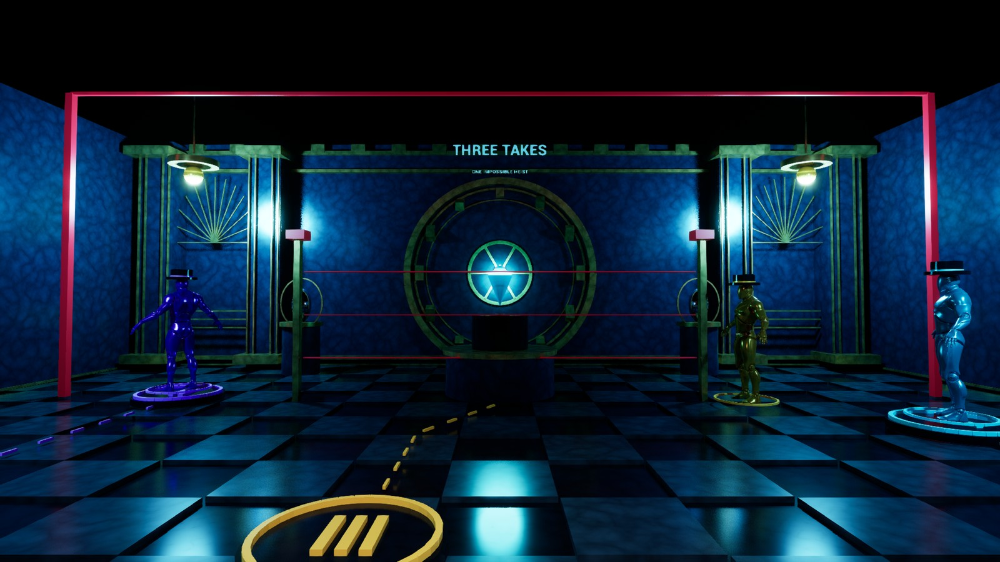
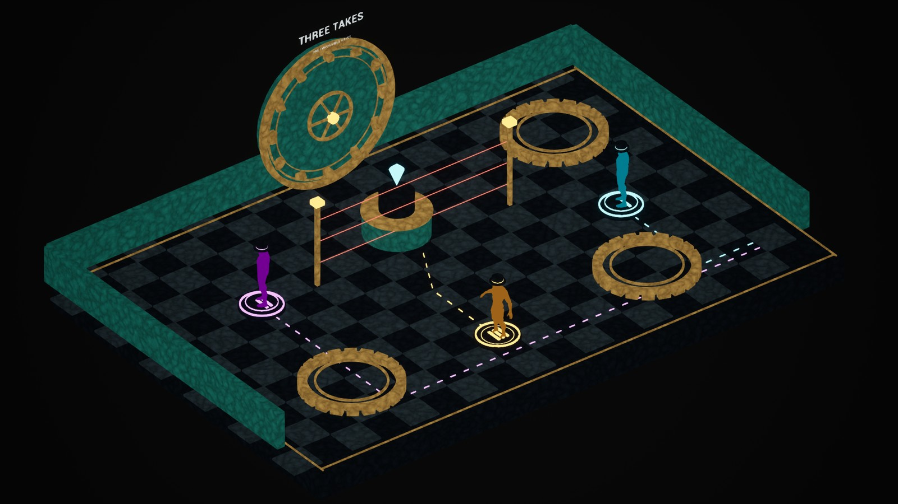
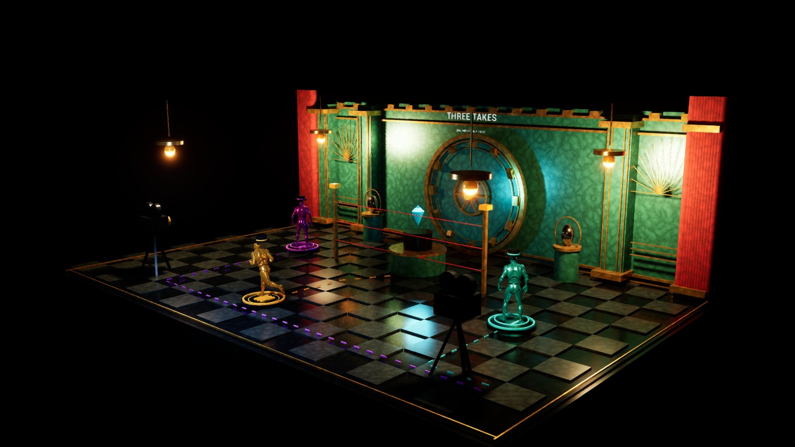
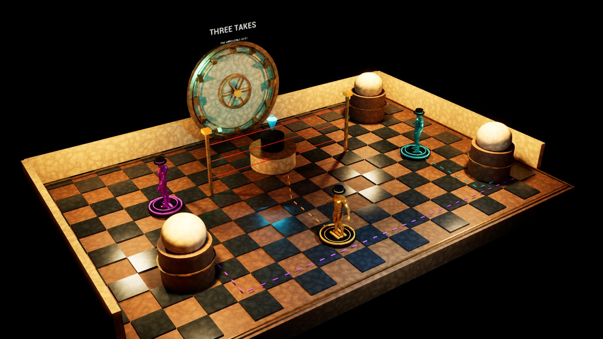
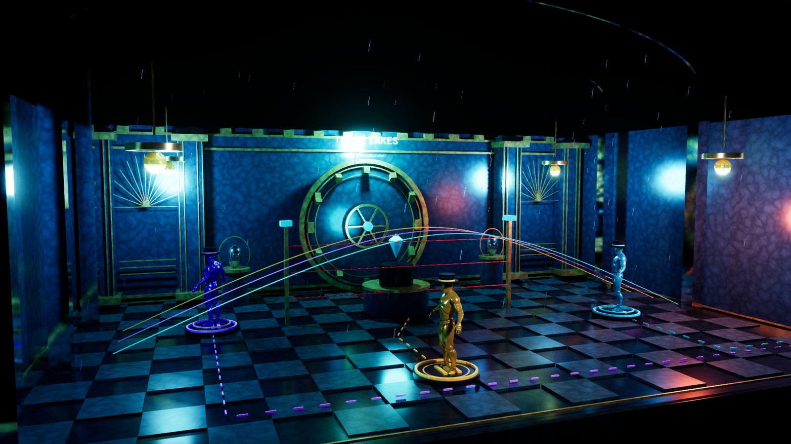

# C03 - ten visual directions (English)

These are translated descriptions of the abandoned recorded-echo heist studies. The images are actual original Unreal renders. They are not final One More Show scenes, and the NVIDIA direction did not implement NVIDIA features.

## V01 - Silver Screen

Side-on orthographic noir in black and ivory. Strong silhouettes and a poster-like frame; the top-down puzzle would need to become a side-view level. Paper2D/flipbooks were proposed.

## V02 - Paper Heist Theatre

A side-on pop-up theatre with flat cutouts and coral curtains. A distinctive link to directing; overlapping paper layers risk hiding interaction. Depth ordering and consistent silhouettes would matter.

## V03 - The Perfect Plan

An almost vertical Art Deco museum view, with low walls and no ceiling. Best fit for the tested three-switch puzzle; tiny characters need strong gestures. One polished room was a feasible scope.

## V04 - Neon Negative

A high fixed camera over a dark data centre, with cyan and magenta routes. Emissive paths explain timing quickly; excessive bloom could obscure lasers and echoes.

## V05 - The Last Take

Full 3D third-person museum thriller. Meeting your own recorded double has cinematic potential; events behind the camera would need planning aids and off-screen cues.

## V06 - Your Own Accomplice

Full 3D first-person vault, hands and a small display for earlier takes. Immediate personal involvement; the weakest overview of simultaneous actions and a higher interaction-animation cost.

## V07 - The Theft Mechanism

A restricted-rotation isometric clockwork vault diorama. Readable board-like play with real depth; decorative moving gears could become visual noise and resemble existing clockwork games.

## V08 - Heist on a Film Set

Fixed wide film cameras around a luxury bank set, with visible lights and curtains. A strong Director's Cut connection; camera changes risk hiding switches or confusing controls.

## V09 - Vault in a Box

A macro view of a handmade wooden and ceramic miniature. Rich materials without realistic humans; scale must be convincing, and stop-motion styling must not compromise input precision.

## V10 - Cathedral of Time

An ambitious full 3D black-stone, chrome and glass vault with coloured time trails. High visual potential; high GPU and reconstruction risk. NVIDIA integration was a proposal only, never a shipped feature.

