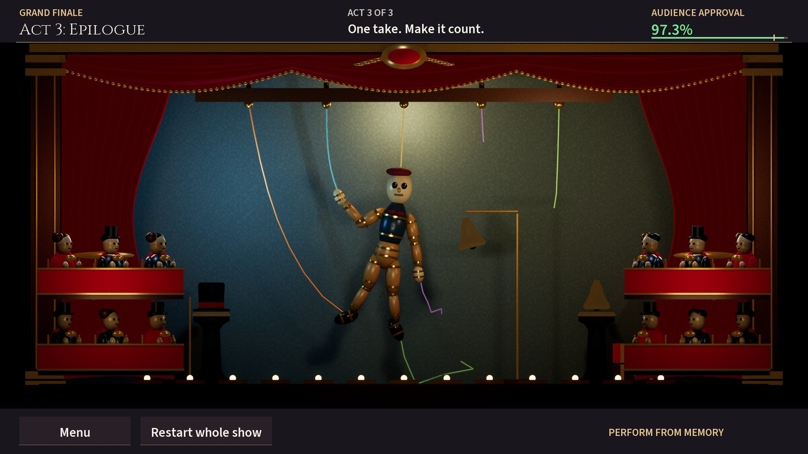
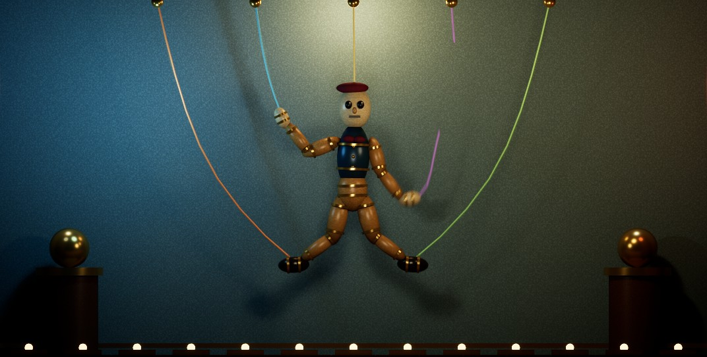
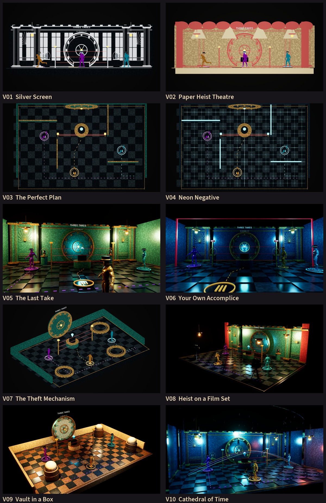
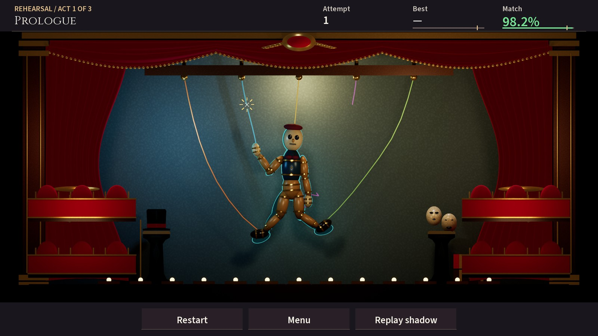
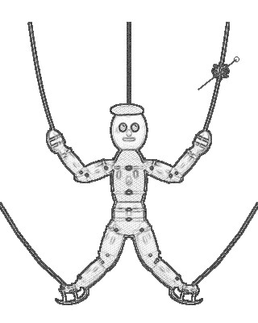
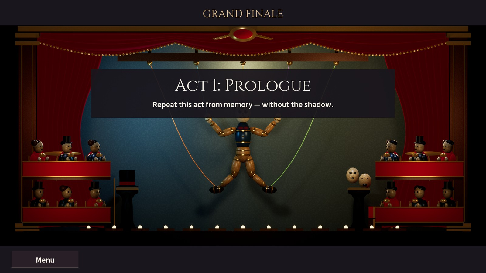
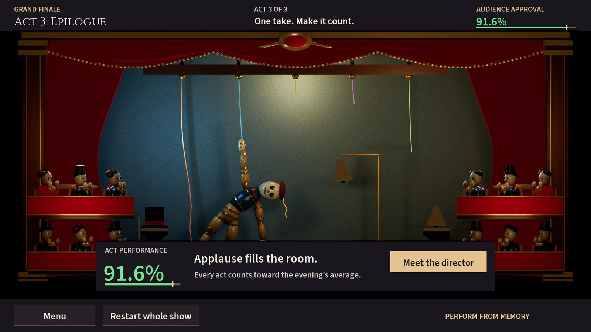
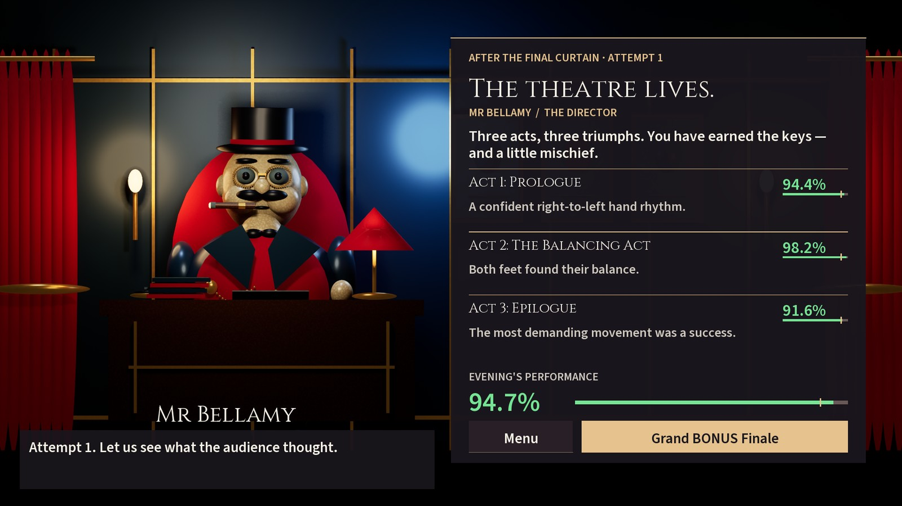
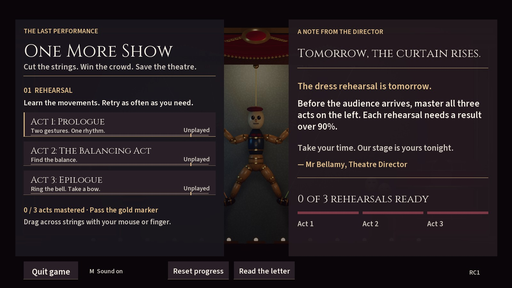

# One More Show - Glass Box

**Maciej Matyka · Release Candidate 1 · v0.18.0**

*Cut the strings. Win the crowd. Save the theatre.*

[Download the illustrated PDF](OneMoreShow-GlassBox-RC1.pdf) · [All 45 translated user prompts](PROMPTS-EN.md) · [Version trail](DEVELOPMENT-TIMELINE.md) · [Sources and credits](SOURCES.md)

## One More Show

A physical marionette. Five strings. One theatre to save.

Watch a shadow performance, then cut real simulated strings to reproduce it. Rehearse three acts with guidance; perform them from memory for an audience. A result strictly above 90% is success. Mr Bellamy judges the evening, and his patience has limits.

Created in Unreal Engine 5.8.4 for Director's Cut. Human direction by Maciej Matyka; coding, iteration support and documentation with OpenAI Codex. Windows Development build. This report is an English editorial account of the available project archive.

RC1 gameplay, captured from the packaged Unreal application. Automated input; real Chaos simulation and computed score.

## The human chose the cut

The process began with a request to preserve everything from prompt one. Twenty AI-proposed concepts led to seven small HTML experiments. A recorded-echo heist received a second level, market research and ten Unreal visual studies. It was not the game that shipped.

Maciej then proposed the defining combination: a fully physical puppet on five cuttable strings, a recorded shadow to imitate, a 2.5D presentation and percentage scoring. He selected this direction and named it Shadow Theatre. One More Show became the final title.

The human selected scope, rejected unsatisfying behaviour, relayed tester feedback and approved the assets and release identity. Codex wrote and revised code, authored procedural scenes, used build and capture tools, researched sources and maintained evidence. No language model runs inside the game. Exact model identifiers for every earlier turn were not recorded and are not reconstructed.

> Imagine a ragdoll hanging from strings attached to its hands and feet ... It is also attached by the head. Everything uses full physics. *

<small>P0006 excerpt. * Translated from the original Polish prompt.</small>

Early native puppet prototype, cropped to the game scene. This is the selected C21 direction, not the earlier heist study.

## Twenty doors, seven experiments

These are English descriptions of the first twenty proposals, not claims of market novelty. Maciej selected C01, C03, C09, C10, C12, C15 and C19 for standalone offline HTML/JS prototypes. Each tested a small playable mechanic before committing to Unreal.

C03 was expanded into a coordinated second heist level. C12 gained a five-track Foley timeline: placed sounds changed autonomous scene behaviour. Those experiments remain archived even though neither became the final game.

The earlier C15 already involved cutting a marionette's strings to escape. The later human brief transformed the objective into imitation of a target performance, adding a measurable physical comparison and a natural rehearsal-to-premiere structure.

- C01 Cut the Bullet - edit events out of a timed puzzle.
- C02 Out of Frame - a monster moves outside the active camera.
- C03 Heist in Three Takes - cooperate with recorded versions of yourself.
- C04 One More Take! - direct a comic stunt sequence.
- C05 The Final Version of the Truth - edit evidence in a mystery.
- C06 The Deleted Scenes Bin - a discarded extra escapes a film.
- C07 Monster on the Beat - conduct a rhythmic kaiju movie.
- C08 Editing Memories - choose which memories to preserve.
- C09 Final Cut: Arena - remove tactical rules with cards.
- C10 The Director Cuts Costs - dismantle a company as strategy.
- C11 Match Cut - travel through visually similar objects.
- C12 Foley God - sounds rewrite what happens in a scene.
- C13 Wrong Genre - switch the rules of cinematic genres.
- C14 Wild Shot - stealth while filming wildlife.
- C15 On Strings - a physical marionette cuts its way free.
- C16 Not in the Script - director-and-actor cooperation.
- C17 Cross Section - rescue by slicing the set.
- C18 Editing-Room Chase - rearrange a race route.
- C19 The Hero Must Survive - stage convincing near misses.
- C20 The Final Cut - fight the director of your own game.

## A promising route we left behind

C03's recorded-echo cooperation had clear precedents. Research used developer and store pages, including Echo Heist and Time Rifters; it was a descriptive comparison, not competitor playtesting or proof of uniqueness. We did not label it an unprecedented invention.

Ten actual Unreal renders explored 2D, top-down and full 3D directions, framing, silhouettes and lighting. One ambitious direction considered NVIDIA technologies. These were concept studies for the heist, not assets from the final puppet game. The archived NVIDIA proposal was never an implementation.

The decision to pivot came from the user's new brief. Preserving the abandoned research makes that choice visible instead of rewriting history around the finished game.

V01-V10: original Unreal concept renders for the abandoned C03 heist. English descriptions and trade-offs are in CONCEPTS-EN.md.

## Physics is the performance

The marionette uses 15 rigid bodies and articulated strings in Unreal's Chaos solver. Planar constraints keep the action readable from a fixed 2.5D camera while the bodies and constraints remain three-dimensional. A cut inside a string piece splits its physical mass and carries velocity into the resulting pieces.

The reference is captured from the same staged simulation. Scoring compares body positions and orientation over the post-cut movement; the first act emphasizes the arms. It is a continuous similarity measure, not merely a check that the correct button was pressed.

The first successful cut starts the reference clock. Before it, the puppet remains physically alive. There is no teleport at the cut. A wrong first rope still starts the attempt; missing a rope or pressing a HUD control does not. Later cuts retain their timing challenge.

Different idle states can produce small differences from the fixed shadow. This is deliberate. Maciej preferred approximate performance and readable mismatch over a system engineered to guarantee 100%.

> We are not aiming for 100%, but roughly the planned fall of the puppet. *

<small>P0020 excerpt. * Translated from the original Polish prompt.</small>

Real puppet and reference shadow during rehearsal. Natural divergence is visible and contributes to the score.

## Three failures that improved the game

1. The first-cut timing trap. Early players had to catch an unclear starting moment. Synchronizing the first cut helped, but pausing the puppet felt wrong. Live waiting fixed the flow. An adaptive reference simulation then reduced mismatch too far; the user rejected it. Version 0.7 restored the fixed recorded shadow and retained the strict success threshold.

2. Replay flicker. A press that opened the shadow could survive world travel and immediately skip it. The final fix commits HUD buttons on release over the captured button, cancels a drag away, keeps pointer state in the viewport and requires a fresh stage press to skip. A disabled Replay button cannot act as a skip target.

3. The stick-figure letter. An initial explanatory drawing looked childish. It was replaced with five seconds of actual Unreal puppet motion, including a physical cut, processed into silhouette contours and graphite-like hatching. The 150-frame flipbook is now part of the letter.

These were corrections to observed problems. The archive retains failed candidates and test results rather than only the successful screenshots.

> Make it by recording the screen of the game ... then transform it into lines like a pencil sketch. *

<small>P0037 excerpt. * Translated from the original Polish prompt.</small>

Actual gameplay became the letter's pencil animation. Recording used automated production cuts, not a claim of human play footage.

## A theatre with a reason to perform

A tester found the physical challenge playable but lacking purpose. Eight narrative or mechanical directions were discussed. Maciej selected saving the theatre and a rehearsal/premiere structure. Ticket pricing and a deeper economy were considered and left out.

The letter sets the stakes. The menu presents three rehearsals: Act 1: Prologue, Act 2: The Balancing Act and Act 3: Epilogue. Passing each above 90% unlocks Grand Finale. Its green action communicates readiness; the locked state gives the player a clear next step.

Grand Finale has one take per act and no reference shadow. The same twelve spectators arrive once, then stay for the evening. Curtains close between acts, props identify the scene, and the final verdict uses the arithmetic mean of the three act scores. The bell is a physical interaction, not a decorative score label.

Successful performances unlock a comic bonus in which the director becomes the suspended puppet. This uses the existing cutting system rather than introducing an unrelated reward mechanic.

Grand Finale: occupied audience boxes and the staged entrance distinguish performance from rehearsal.

## Feedback the player can read

The HUD was repeatedly simplified: scene, attempts, best score and current similarity; the gameplay timer was removed. Restart, Menu and Replay have distinct roles. Rehearsal success leads to a specifically named next act rather than an ambiguous repeat button.

Every displayed percentage has a meter. Values and bars use one smooth burgundy-to-green palette. Results count up for one second with small HUD particles. Applause begins only when the revealed successful score crosses 90%; a failed result gets restrained murmuring. The premature visual applause phase was removed.

Cinzel headings and Source Sans 3 body text support the theatrical setting. The normal build offers English, Polish and French, selected from the system language with English fallback. The contest package uses an English-only presentation marker; this preserves the multilingual development version.

Red curtains use a separate decorative Verlet/PBD simulation. They are not Chaos Cloth. Percentage particles are analytic Canvas effects, not a claim of a Niagara implementation.

The completed result panel: consistent percentage colour, meter and measured feedback.

## One more show. One less nerve.

Mr Bellamy is a corpulent director behind a desk, with a cigar. His report names which acts succeeded and uses recorded cut timing, missing cuts and body-motion diagnostics. This is authored conditional text, not generated dialogue or voice acting.

Completed Grand Finale runs drive an escalating office sequence. At show 8 a glass eye drops. At 12 he stands and overturns the desk. At 25 Ms Vale takes over. At 100 she fires at the screen and the theatre closes with a persistent Game Over.

The gag animations are timed component animation on original procedural geometry. The puppet and bonus remain Chaos gameplay. Synthetic counters test the late-show thresholds; we did not manually play one hundred complete performances.

Closure is enforced in the game state and save files, including a separate marker. It is not protection against someone manually editing files or launching an older release. The ordinary reset remains available before closure and creates a backup.

The office gives an act-by-act review of the actual performance. Late-show spoilers are documented separately in the internal archive.

## Evidence, with its limits attached

Version 0.17 recorded 384 checks: 207 escalation checks, 112 presentation checks, 56 real-story checks and 9 persistence checks. The final cosmetic candidate repeated the escalation and persistence checks; the earlier candidate supplied the story and presentation runs. This is not 384 independent human playtests.

A real three-act Chaos run produced 94.4220%, 98.1612% and 91.6426%, averaging 94.7419%. First-cut pose jump was 0 cm in each recorded act. These results are evidence for that build and test setup, not promises of identical scores across hardware.

RC1 adds targeted branding, localization, English contest mode and package checks. Its trailer is recorded from the packaged application using automatic calls to the production cutting function. The simulation and scores are real; capture input is automated. The one-second reveal uses the capture frame clock so offline image writing does not distort its duration.

The film's music and effects are mixed in post from the same licensed assets, aligned to recorded cut, bell and verdict events. It is not presented as loopback audio. See VERIFICATION.json and VIDEO-PROVENANCE.md for the final measured results.

Physical mobile devices, minimum-spec hardware and NVIDIA-specific features have not been tested or implemented. The main remaining evidence gap is broader blind playtesting.

## What was made, what was licensed

Original work: C++ gameplay, scoring and input handling; procedural puppet, office, audience and props assembled from engine geometry; theatre materials, layout and decorative curtain simulation; UI, story logic, translations and original office Foley synthesis. Codex assisted their creation under human direction.

Sourced content: Unreal Engine basic shapes and runtime; six WeLoveIndies assets licensed for this project under FREE & DEMO; Cinzel and Source Sans 3 fonts under SIL OFL 1.1. The project was licensed under its working title Shadow Theatre. Renaming it does not represent a separate game.

The sound list is explicit: Metal Scissors Close 01; Hemp Rope Twist Squeak Very Short 01; Brass Small Tinkle 01; Crowd Applause Short 01; Male Crowd Mumbling 01; and The Puppet Master. The public repository distributes finished video and documentation, not standalone licensed audio samples.

Tools: Unreal Engine, OpenAI Codex, Git/GitHub, PowerShell, JavaScript, Python and FFmpeg. Research consulted primary developer, store and documentation sources. No NVIDIA award implementation is claimed. AI use is disclosed as a development process, not a substitute for gameplay quality.

The private archive preserves Polish originals, visible assistant responses, tool records, assets, variants and hashes. The public edition contains this report, all available user prompts in English, the concept trail, source citations, verification and release artifacts. It does not expose credentials, purchase identifiers or unrelated machine data.

## A release candidate, not a rewritten past

The numbered progression is preserved: native prototype 0.1; free-position cuts 0.2; teaching/replay work 0.3; first-cut synchronization 0.4; live waiting 0.5; rejected adaptive reference 0.6; restored mismatch 0.7; automatic preview 0.8; theatre and props 0.9; licensed audio and typography 0.10; narrative 0.11; crowd and letter 0.12; localization 0.13; verdict timing 0.14; finale gates and bonus 0.15; input, reset, sketch and polish 0.16; escalation 0.17; One More Show RC1 at 0.18.

The archive starts at 2026-11-12 05:27:04 UTC, after the published 05:00 UTC jam start. This is the archive creation time, not an invented timestamp for every message. Original message timestamps were not available; recording times are kept separately. Previously installed tools and licensed third-party content are declared.

To judge: watch the 1080p gameplay short, read the development record, then run the packaged Windows demo. The public links and exact hashes are listed in the repository README and release. Submission form text is prepared in SUBMISSION.md.

Next work should prioritize blind player tests, first-minute comprehension, a stronger physical prop challenge and more expressive character animation. Mobile and NVIDIA technology remain separate future work, not features quietly added to this release.

Translated prompt excerpts carry an asterisk. All available translated user messages are in PROMPTS-EN.md; they are translations, not original English wording. A compact English decision trail is in DEVELOPMENT-TIMELINE.md.

> I like One More Show. Change the game title to that. *

<small>P0042 excerpt. * Translated from the original Polish prompt.</small>

One More Show RC1: the English contest menu with the selected title and tagline.

## Further evidence

[Ten heist visual studies](CONCEPTS-EN.md) · [Release verification](VERIFICATION.json) · [Video provenance](VIDEO-PROVENANCE.md) · [Submission handoff](SUBMISSION.md)
