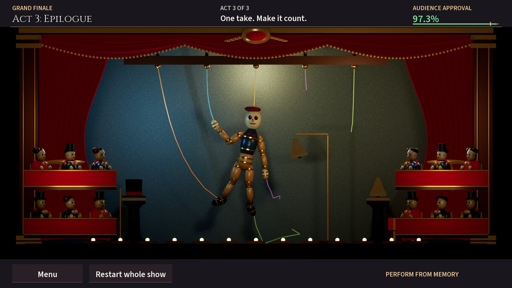

# One More Show

**Cut the strings. Win the crowd. Save the theatre.**

By **Maciej Matyka** · Release Candidate 1 · v0.18.0 · Unreal Engine

## For the jury

- **[Watch the gameplay video](https://maciejmatyka.github.io/one-more-show-jam/)** - 48.2 seconds, 1080p, actual gameplay.
- **[Read the Glass Box](GLASS-BOX.md)** - the English development record from the first prompt.
- **[Open the illustrated 12-page PDF](OneMoreShow-GlassBox-RC1.pdf)**.
- [All 45 translated user messages](PROMPTS-EN.md), [twenty ideas and version decisions](DEVELOPMENT-TIMELINE.md), [ten earlier visual studies](CONCEPTS-EN.md).
- [Verification and hashes](VERIFICATION.json), [video provenance](VIDEO-PROVENANCE.md), [sources and credits](SOURCES.md).

## The game

Recreate a shadow performance by cutting the strings of a physical marionette. Learn three acts in rehearsal, then face an audience without a guiding shadow. Beat 90% to save the theatre. Mr Bellamy's notes become less patient with every completed show.

This repository contains public jury documentation and the finished video. Source code, original Polish transcripts, licensed raw assets, older versions and the Windows package remain in the private development repository. The Windows ZIP is prepared for upload by the entrant.

## Transparent process

Human direction and concept selection: Maciej Matyka. AI assistance: OpenAI Codex. The report records failed approaches, tester feedback and actual verification, including the distinction between real physics scores and synthetic progression fixtures.

*Translated prompts are marked with an asterisk and the note: "Translated from the original Polish prompt."*

## Release-candidate status

194 distinct targeted RC1 checks passed. The trailer uses real simulated gameplay with automated input and post-mixed project audio. Full independent audiovisual review and a fresh-machine player test remain recommended. The provider intro versus contest-logo rule is an explicit pre-submission clarification item; see [submission handoff](SUBMISSION.md).

No itch.io entry has been submitted by an automated agent.
